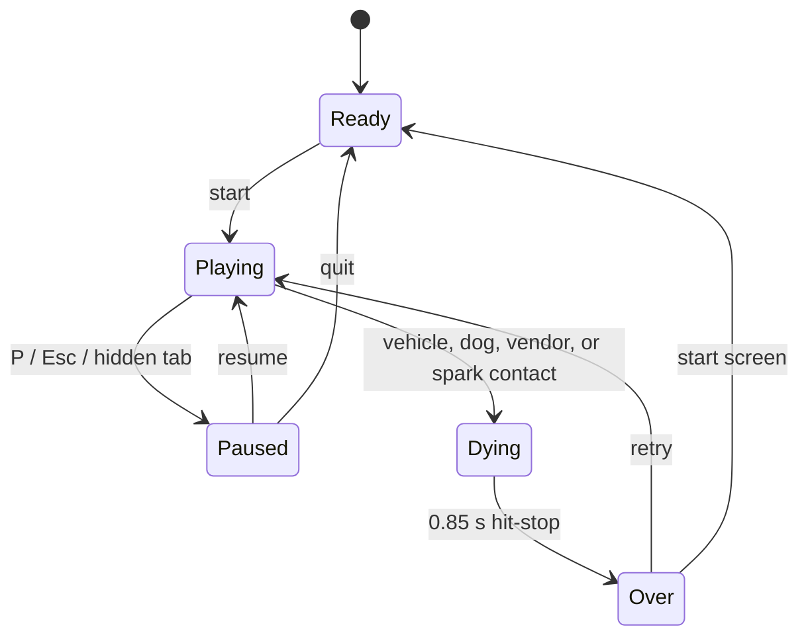

# Kalsada-Cat

Kalsada-Cat is a pixel-art browser arcade game about a black cat crossing an endless Filipino street. Jeepneys, tricycles, and buses run through the lanes. Sari-sari stores, fishball carts, monobloc chairs, and sagging power lines crowd the sidewalks. Stray dogs, taho vendors, potholes, and sparking wires make every island a route puzzle. One hit ends the run, unless an anting-anting, a payong, or a balut saves you.

The game runs entirely on the client. It has no backend, no accounts, and no binary assets: every sprite is drawn at runtime, and all music and effects are synthesized with the Web Audio API.

## Run it

```bash
npm install
npm run dev
```

Vite prints a local URL. Use `npm run build` for the production bundle in `dist/`, and `npm run preview` to serve that bundle locally.

Requires Node 22.12 or newer. `.nvmrc` pins Node 24.

## Controls

| Action | Keyboard | Touch |
| --- | --- | --- |
| Move one tile up, down, left, right | Arrow keys or WASD | Swipe in that direction |
| Hop forward | Up arrow or W | Tap the play field |
| Start / retry | Space or Enter | Button |
| Pause / resume | P or Escape | Pause button |
| Mute all sound | M | SFX button |
| Music on / off | N | BGM button |
| Switch English / Filipino | EN / FIL buttons on the start, pause, or game-over card | Same buttons |
| Pick a cat color | Start-screen swatches | Same swatches |

The game defaults to the saved language, then the browser language (`fil` or `tl`), then English. Switching updates the HUD, screens, controls, accessibility labels, and shield popup without reloading.

The game buffers one movement input while a hop finishes. Static props block the target tile; roads do not. Moving backward is allowed and costs no points. Barricades block their tile until their timer runs out, then clear.

## Core gameplay loop

1. Read the next lane. Vehicle speed, direction, and length vary by lane.
2. Hop one grid tile. Each hop lasts 115 ms; a tap always moves forward.
3. Cross 2 to 5 lanes, then use the next sidewalk island to reset.
4. Route around the props on the island. Every island keeps one column fully clear, but that column moves from island to island.
5. Collect fishballs (+5), kikiam (+10), or an anting-anting charm (+1 shield). Shields stack without a cap; each hit consumes one.
6. Grab power-ups from row 20 onward. They are rare, never spawn in the first 20 rows, and the strong ones wait until row 40.
7. Score one point for every new farthest row and keep moving. A hit with no shield, umbrella, or revive ends the run. The run is endless.

## Obstacles

| Obstacle | Behavior |
| --- | --- |
| Aso (stray dog) | Patrols a two-to-four tile run on a sidewalk island. Contact hits like a vehicle. Sampaguita calms every dog for 8 s, and a calm dog cannot hurt the cat. |
| Taho vendor | Walks one sidewalk row from edge to edge on a loop, carrying a cart. Contact hits; the vendor never spawns inside the stage. |
| Lubak / baha | A pothole or flood patch on a road tile. Landing on it holds the cat for 150 ms before the next hop. It never deals damage. |
| Parked tricycle | Blocks two sidewalk tiles, forcing a detour. |
| Barricade | Blocks one sidewalk tile for 4 to 8 s, then clears itself. |
| Sparking wire | A sidewalk tile under a power pole sparks for 0.3 s of every second. Touching it while it sparks hits like a vehicle. The flash is drawn from the same clock the hit uses. |
| Tiangge stall, rice sacks | Extra blocking sidewalk props in the provinciya and tiangge districts. |

Every island still guarantees one fully clear column at generation time. Dogs, vendors, and sparks move, so that column can be dangerous for a moment; wait for the safe beat.

## Power-ups

| Item | Effect | Duration |
| --- | --- | --- |
| Traffic enforcer whistle | Stops every vehicle, dog, and vendor | 4 s |
| Payong (umbrella) | Absorbs one hit without consuming a shield; the canopy breaks | Until used |
| Tsinelas (slippers) | Halves hop time; the input buffer still applies | 6 s |
| Halo-halo | Doubles all points, pickups and distance | 10 s |
| Balut | Revives once at the crash tile with 2 s of invulnerability | One per run |
| Turon | Pulls fishballs within 2 tiles one tile at a time until they reach the cat | 8 s |
| Sampaguita garland | Calms every dog and clears one random sidewalk prop near the cat | 8 s |

Timed effects of different kinds stack; picking the same kind again refreshes its timer. The HUD shows each live effect with its remaining seconds. A pickup after row 24 can also be an anting-anting shield, which stacks without a cap.

## Cat colors

The start screen offers six coats: **Black** (`mingming`), **White** (`puti`), **Red** (`pula`), **Yellow** (`dilaw`), **Green** (`luntian`), and **Violet** (`tala`). The choice persists under `kalsada-cat.skin.v1` and applies to the attract-mode cat immediately.

## Scoring and difficulty

| Event | Score or effect |
| --- | --- |
| Reach a new farthest row | +1 |
| Fishball | +5 |
| Kikiam | +10 |
| Anting-anting | Adds one shield charge; charges stack without a cap |
| Revisit an earlier row | No score |

Traffic starts with two-lane roads. The generator raises lane count to three, four, and finally five. It also raises speed, tightens gaps, and introduces tricycles after roughly 16 rows and buses after roughly 55 rows. Early roads are the tutorial.

Each road uses the same vehicle type in a lane so speeds stay coherent. A lane's vehicles move in one direction and wrap behind the rear-most vehicle, which preserves spacing. Re-entering vehicles always start fully outside the stage, and every generated row advances, so vehicles cannot appear in the middle of a road when the camera reaches them. The camera eases toward the cat, while rows generate ahead of the view.

## Game state logic



| State | Behavior |
| --- | --- |
| Ready | Start screen. The street runs in attract mode behind the card; best score is visible. |
| Playing | Input, traffic, actors, hazards, pickups, scoring, effects, and camera follow run. |
| Paused | All simulation stops. The overlay offers resume, restart, and quit. Hiding the tab pauses automatically. |
| Dying | Traffic and actors freeze for impact, the screen shakes, and the cat shows hit marks. Input is ignored. |
| Over | Final score card, record badge, retry, and start-screen actions. Traffic keeps moving behind the overlay. |

A new run creates a fresh world, places the cat at the starting sidewalk, resets score, shields, and every timed effect, and starts input immediately. The best score survives runs.

High scores live in `localStorage` under `kalsada-cat.best.v1`. Language lives under `kalsada-cat.lang.v1`; sound under `kalsada-cat.muted.v1`; music under `kalsada-cat.music.v1`; cat color under `kalsada-cat.skin.v1`. The engine loads the value before the first frame, updates the live best as points land, and the UI persists a new record immediately. `NEW RECORD!` compares the final score against the best score at the start of that run, not against the live value the run already raised.

The game pauses when the document becomes hidden. The pause overlay stays up when the player returns, so a run never resumes behind the player's back.

## Filipino street dressing

All sprites are drawn at runtime on a 260x420 canvas and scaled with nearest-neighbor rendering.

- The street rotates through six districts. Each has its own road tone, curb, lane paint, ground marks, and prop mix:

| District | Surface | Street furniture |
| --- | --- | --- |
| Barangay | Cool gray concrete with expansion joints, weeds, and drain grates | Sari-sari stores, monobloc chairs, plants, trash bags, no-crossing signs, parked tricycles |
| Palengke | Terracotta tile with produce specks, stains, and patched asphalt | Fruit crates, rice sacks, fishball carts, stores, chairs, signs |
| Provinciya | Dusty dirt road with tire ruts and grass-toned sidewalks | Rice sacks, potted plants, stores, chairs, signs |
| City | Blue-gray pavers with utility covers and crisp lane paint | Signs, planters, stores, chairs, trash bags, parked tricycles |
| Tiangge | Lilac pavers from the night market | Striped stalls, tarpaulin canopies, carts, chairs, trash |
| Baywalk | Weathered boardwalk planks with salt marks and green-gray curbs | Painted benches, plants, carts, trash bags |

- Three sari-sari store variants share the sidewalk: **SARI-SARI**, **TINDAHAN**, and **KARINDERYA**, with different awnings, signs, and walls.
- Fishball carts come in three umbrella palettes. Glass cabinets hold fishball skewers; a vendor stands behind the cart.
- Street furniture includes blue and pink monobloc chairs, tied trash bags, potted plants, no-crossing signs, wooden produce crates, painted benches, rice sacks, tiangge stalls, parked tricycles, and wooden barricades with cones.
- Taho vendors walk the sidewalk with a cart, flipping to face their direction. The stray dog is drawn as a side view and flips with its patrol direction; a small "Z" marks a calmed dog.
- Road potholes and floods are drawn per tile from the world's lubak set. Sparking wire flashes use the same clock as the damage check.
- Wooden utility poles carry transformers and three sagging wires across the road. Wires draw behind the cat so play stays readable.
- Jeepneys use twelve color schemes and three decoration styles. Roof cargo, chrome trim, side checks, and accent stripes change per vehicle.
- Tricycles and buses use the same twelve palettes plus their own variants. Tricycles add roof cargo or a pennant and side stripe; buses add roof luggage or a lower livery band.
- Road surfaces use theme-specific asphalt tones, dashed lane lines, direction-change paint, curbs, sidewalk pavers, drains, and manhole covers.
- The 16x16 cat has two tail frames, a hop arc, dust particles, impact shakes, a golden shield aura, and a small death overlay.

## Sound and music

All audio is synthesized at runtime with the Web Audio API; the repository ships no audio files.

- **Music** is an original two-bar chiptune loop in A minor at about 107 BPM: square lead, triangle bass, and a high-passed noise hat, scheduled with a lookahead clock. `N` or the BGM button toggles it; the choice is stored under `kalsada-cat.music.v1`.
- **Effects**: hop, bump, coin, shield pickup, stumble, shield break, payong break, revive, crash, game over, start, and click. `M` or the SFX button mutes everything through the master gain.
- Music and effects start only after the first user gesture, which satisfies browser autoplay rules.

If you want to swap in recorded audio, these CC0/attribution-friendly sources fit the game's tone:

| Source | What it offers |
| --- | --- |
| [Joth — *Next to You* (OpenGameArt, CC0)](https://opengameart.org/content/next-to-you) | A gentle 8-bit loop that suits attract mode. CC0, so no attribution is required, though the author appreciates it. |
| [OpenGameArt music with the CC0 filter](https://opengameart.org/art-search-advanced?keys=&field_art_type_tid%5B%5D=12&field_art_licenses_tid%5B%5D=4) | Chiptune, arcade, and loop-tagged tracks in the public domain. |
| [Freesound CC0 search](https://freesound.org/search/?f=license%3A%22Creative+Commons+0%22&q=chiptune) | Raw one-shots and loops for effects. |
| [Kenney audio packs (CC0)](https://kenney.nl/assets?q=audio) | UI clicks, coins, and impact sounds. |

Keep credits in this section if you add a track, and check the license on the item page before shipping.

## Project layout

| Path | Purpose |
| --- | --- |
| `src/game/engine.ts` | State machine, movement, scoring, hazard collisions, timed power effects, camera, particles, run records |
| `src/game/world.ts` | Endless row generation, lanes, vehicles, props, actors (dogs, vendors), hazards, pickups, safe-column routing |
| `src/render/renderer.ts` | Scene composition, row rendering, traffic, actors, cat, wires, hazards, effects |
| `src/render/sprites.ts` | Procedural pixel art for the cat skins, vehicles, props, actors, and pickups |
| `src/render/tiny-font.ts` | 3x5 bitmap font for shop signs and score popups |
| `src/ui/audio.ts` | Web Audio chiptune music loop and sound effects |
| `src/ui/i18n.ts` | English and Filipino copy, browser language detection, game-over announcement |
| `src/ui/storage.ts` | Local best score, sound, music, language, and cat color |
| `src/main.ts` | Canvas bootstrap, HUD, effect chips, cat swatches, screens, keyboard, swipe, pause, and animation loop |
| `src/styles.css` | Responsive frame, pixel panels, overlays, swatches, effect chips, and controls |
| `tests/game.test.ts` | World invariants, district coverage, traffic spacing and wraps, scoring, pickups, hazards, power-ups |

## Test and verify

```bash
npm test
npm run check
npm run build
```

The test suite covers:

- Sidewalk blocks always expose at least one fully clear column.
- All six districts appear as the world grows.
- Lanes contain spaced vehicles before and after repeated wrap cycles.
- Wrapped vehicles re-enter only from outside the stage.
- Traffic in rows ahead of the camera keeps moving.
- Pickups never overlap blocking props.
- Distance scoring, live best updates, and pause freezing.
- Fishball collection and bonus scoring.
- Game over, record reporting, and the transition after hit-stop.
- A shield stack absorbs one hit per charge; a hit at zero ends the run.
- Power-ups spawn only after row 20, and every kind appears across seeds.
- Dogs stay inside their patrol run; sampaguita stops them and removes their contact damage.
- Frozen time stops dogs and vendors; barricades clear and free their tile.
- Lubak exists only on road rows and causes a stumble, not damage.
- Enforcer, tsinelas, halo-halo, payong, balut, turon, and the turon magnet pull behave as documented.

## Deploy to Vercel

The repository is a static Vite site. `vercel.json` pins the Vite framework, the build command, the `dist` output, and immutable font caching. No environment variables or server functions are required.

Dashboard flow:

1. Push the repository to GitHub, GitLab, or Bitbucket.
2. Import the repository in Vercel.
3. Keep the detected Vite settings. Build runs `npm run build`; output is `dist`.
4. Deploy.

CLI flow:

```bash
npm install
npm test
npm run build
npx vercel --prod
```

High scores are local to each browser. Vercel serves only static files, so a new deployment does not migrate or merge player records.
