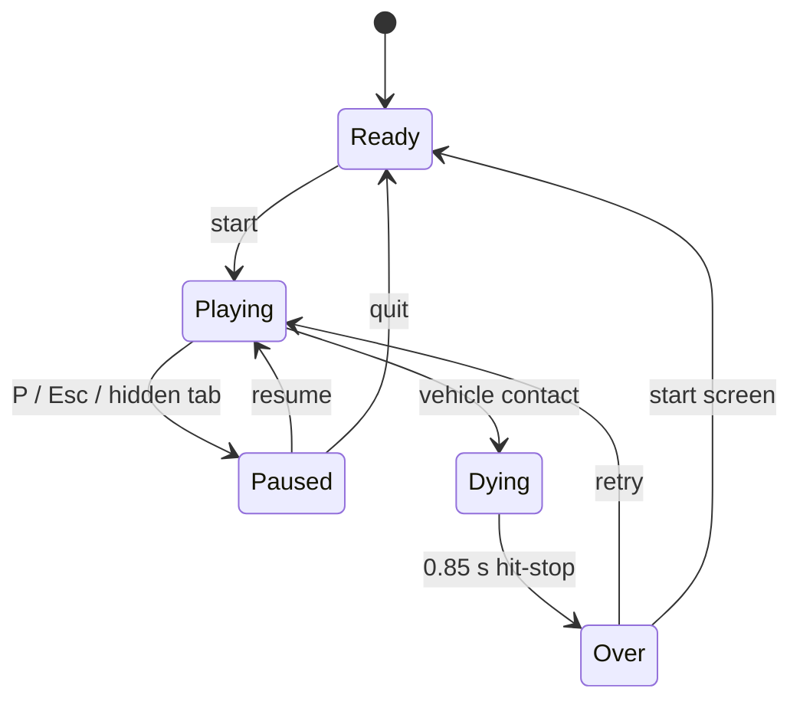

# Kalsada-Cat

Kalsada-Cat is a pixel-art browser arcade game about a black cat crossing an endless Filipino street. Jeepneys, tricycles, and buses run through the lanes. Sari-sari stores, fishball carts, monobloc chairs, and sagging power lines crowd the sidewalks. One hit ends the run.

The game runs entirely on the client. It has no backend, no accounts, and no build-time assets beyond local font files.

## Run it

```bash
npm install
npm run dev
```

Vite prints a local URL. Use `npm run build` for the production bundle in `dist/`, and `npm run preview` to serve that bundle locally.

Requires Node 22.12 or newer. `.nvmrc` pins Node 24.

## Controls

| Action | Keyboard | Touch |
| --- | --- | --- |
| Move one tile up, down, left, right | Arrow keys or WASD | Swipe in that direction |
| Hop forward | Up arrow or W | Tap the play field |
| Start / retry | Space or Enter | Button |
| Pause / resume | P or Escape | Pause button |
| Mute / unmute | M | Sound button |

The game buffers one movement input while a hop finishes. Static props block the target tile; roads do not. Moving backward is allowed and costs no points.

## Core gameplay loop

1. Read the next lane. Vehicle speed, direction, and length vary by lane.
2. Hop one grid tile. Each hop lasts 115 ms; a tap always moves forward.
3. Cross 2 to 5 lanes, then use the next sidewalk island to reset.
4. Route around the props on the island. Every island keeps one column fully clear, but that column moves from island to island.
5. Collect fishballs (+5), kikiam (+10), or an anting-anting charm (one-hit shield). An extra anting while shielded converts to +15 points.
6. Score one point for every new farthest row and keep moving. A jeepney, tricycle, or bus hit ends the run unless a shield is active. The run is endless.

## Scoring and difficulty

| Event | Score or effect |
| --- | --- |
| Reach a new farthest row | +1 |
| Fishball | +5 |
| Kikiam | +10 |
| Anting-anting | Shield absorbs one vehicle hit; +15 if already shielded |
| Revisit an earlier row | No score |

Traffic starts with two-lane roads. The generator raises lane count to three, four, and finally five. It also raises speed, tightens gaps, and introduces tricycles after roughly 16 rows and buses after roughly 55 rows. Early roads are the tutorial.

Each road uses the same vehicle type in a lane so speeds stay coherent. A lane's vehicles move in one direction and wrap behind the rear-most vehicle, which preserves spacing. The camera eases toward the cat, while rows generate ahead of the view.

## Game state logic



| State | Behavior |
| --- | --- |
| Ready | Start screen. The street runs in attract mode behind the card; best score is visible. |
| Playing | Input, traffic, collisions, pickups, scoring, and camera follow run. |
| Paused | All simulation stops. The overlay offers resume, restart, and quit. Hiding the tab pauses automatically. |
| Dying | Traffic freezes for impact, the screen shakes, and the cat shows hit marks. Input is ignored. |
| Over | Final score card, record badge, retry, and start-screen actions. Traffic keeps moving behind the overlay. |

A new run creates a fresh world, places the cat at the starting sidewalk, resets score and shield, and starts input immediately. The best score survives runs.

High scores live in `localStorage` under `kalsada-cat.best.v1`. The engine loads the value before the first frame, updates the live best as points land, and the UI persists a new record immediately. `NEW RECORD!` compares the final score against the best score at the start of that run, not against the live value the run already raised.

The game pauses when the document becomes hidden. The pause overlay stays up when the player returns, so a run never resumes behind the player's back.

## Filipino street dressing

All sprites are drawn at runtime on a 260x420 canvas and scaled with nearest-neighbor rendering.

- Three sari-sari store variants share the sidewalk: **SARI-SARI**, **TINDAHAN**, and **KARINDERYA**, with different awnings, signs, and walls.
- Fishball carts come in three umbrella palettes. Glass cabinets hold fishball skewers; a vendor stands behind the cart.
- Street furniture includes blue and pink monobloc chairs, tied trash bags, potted plants, and no-crossing signs.
- Wooden utility poles carry transformers and three sagging wires across the road. Wires draw behind the cat so play stays readable.
- Jeepneys use five color schemes, roof cargo, decorated side panels, and chrome trim. Tricycles are short and quick; buses are long and slow.
- Road surfaces use dashed white lane lines, dashed yellow direction-change lines, yellow curbs, sidewalk pavers, drains, and manhole covers.
- The cat has two tail frames, a hop arc, dust particles, impact shakes, a golden shield aura, and a small death overlay.

## Additional obstacle and power-up ideas

These are designed extensions, not features in the current build.

### Obstacles

| Idea | Behavior |
| --- | --- |
| Aso (stray dog) | Patrols two tiles on a sidewalk. Contact ends the run. A fishball can distract it for one cycle. |
| Lubak / baha | Pothole or flooded tile. The next hop is delayed by 150 ms; it never deals damage. |
| Parked tricycle | Blocks two sidewalk tiles and forces a detour into the next lane. |
| Taho vendor | Crosses one sidewalk row on a timed loop. The cart is a moving wall. |
| Barricade and cones | Block one tile for a few seconds, then clear. Adds route changes without permanent dead ends. |
| Sparking wire | A sidewalk tile under a pole sparks on a one-second cycle. Contact while active ends the run. |

### Power-ups

| Idea | Behavior |
| --- | --- |
| Traffic enforcer whistle | Freezes every vehicle for four seconds. Rare; spawns after 40 rows. |
| Payong (umbrella) | Adds a second shield layer. The cat carries a visible canopy. |
| Tsinelas (slipper) | Doubles hop speed for six seconds. The input buffer still applies. |
| Halo-halo | Doubles all points for ten seconds. Pickups and distance both count. |
| Balut | Revives once at the crash tile with two seconds of invulnerability. Single use per run. |
| Turon | Attracts fishballs within two tiles for eight seconds. |
| Sampaguita garland | Calms stray dogs and clears one random sidewalk prop. |

Balance rules for any of these: do not spawn in the first 20 rows, cap one power-up effect at a time, and keep the effect shorter than the average time to the next sidewalk.

## Project layout

| Path | Purpose |
| --- | --- |
| `src/game/engine.ts` | State machine, movement, scoring, collisions, camera, particles, run records |
| `src/game/world.ts` | Endless row generation, lanes, vehicles, props, pickups, safe-column routing |
| `src/render/renderer.ts` | Scene composition, row rendering, traffic, cat, wires, effects |
| `src/render/sprites.ts` | Procedural pixel art for the cat, vehicles, props, and pickups |
| `src/render/tiny-font.ts` | 3x5 bitmap font for shop signs and score popups |
| `src/ui/audio.ts` | Web Audio chiptune effects |
| `src/ui/storage.ts` | Local best score and sound preference |
| `src/main.ts` | Canvas bootstrap, HUD, screens, keyboard, swipe, pause, and animation loop |
| `src/styles.css` | Responsive frame, pixel panels, overlays, and controls |
| `tests/game.test.ts` | World invariants, traffic spacing, scoring, pickups, collisions, shield behavior |

## Test and verify

```bash
npm test
npm run check
npm run build
```

The test suite covers:

- Sidewalk blocks always expose at least one fully clear column.
- Lanes contain spaced vehicles before and after repeated wrap cycles.
- Pickups never overlap blocking props.
- Distance scoring, live best updates, and pause freezing.
- Fishball collection and bonus scoring.
- Game over, record reporting, and the transition after hit-stop.
- Shield consumption and the following fatal hit.

## Deploy to Vercel

The repository is a static Vite site. `vercel.json` pins the Vite framework, the build command, the `dist` output, and immutable font caching. No environment variables or server functions are required.

Dashboard flow:

1. Push the repository to GitHub, GitLab, or Bitbucket.
2. Import the repository in Vercel.
3. Keep the detected Vite settings. Build runs `npm run build`; output is `dist`.
4. Deploy.

CLI flow:

```bash
npm install
npm test
npm run build
npx vercel --prod
```

High scores are local to each browser. Vercel serves only static files, so a new deployment does not migrate or merge player records.
